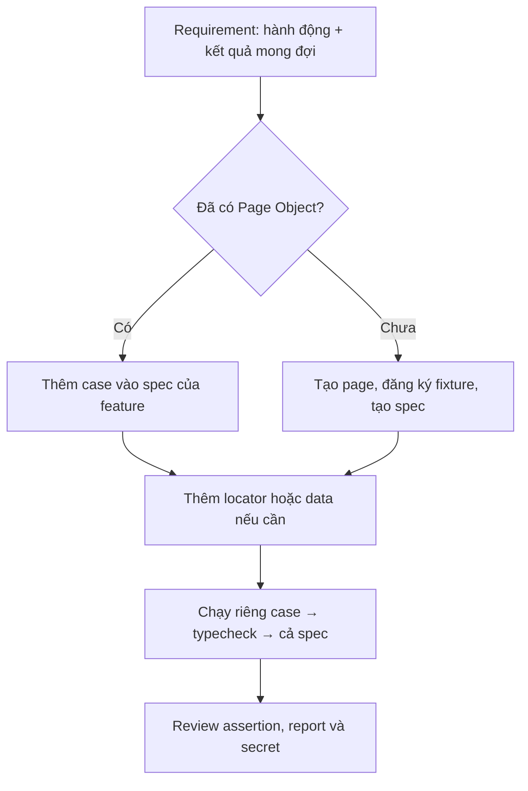

# Coding style & cách thêm UI test

> Playwright + TypeScript, cập nhật 14/10/2026. Đây là bản tra cứu nhanh từ source hiện tại. Mục “Nên làm” là quy ước đề xuất; repo chưa có ESLint/Prettier để tự kiểm tra format.

## 1. Bắt đầu từ đâu?



Luồng code: `test spec → fixture → page/component → UI`. Test data đi vào spec; `config/env.ts` cấp cấu hình. **Spec giữ assertion; page/component giữ locator và action.**

## 2. Cấu hình local

Yêu cầu Node.js 22+, Chromium và kết nối mạng/VPN tới domain `.ynm.local`.

```bash
npm ci
npx playwright install chromium
cp .env.example .env        # chỉ cần nếu đổi URL hoặc chạy login thành công
npm run typecheck
npx playwright test --list  # kiểm tra Playwright nhận test; chưa chạy browser
```

Trong `.env`: `BASE_URL` là origin môi trường test. Test validation Login chạy được với ba biến `LOGIN_EMAIL`, `LOGIN_PASSWORD`, `LOGIN_SUCCESS_PATH` cùng để trống; URL có giá trị mặc định. Test `LOGIN-005` cần **đủ cả ba** biến, trong đó `LOGIN_SUCCESS_PATH` là path thực sau đăng nhập, bắt đầu bằng `/`. Điền thiếu một biến sẽ bị `config/env.ts` báo lỗi. Biến từ shell/CI được ưu tiên hơn `.env`. Không commit `.env` hoặc tài khoản thật.

## 3. Sửa file nào?

| Việc cần làm | File |
| --- | --- |
| Thêm case cho trang đang có | `tests/<feature>/<feature>.spec.ts` |
| Thêm locator hoặc action của màn hình | `pages/<feature>.page.ts` |
| Thêm UI block dùng chung | `components/<name>.component.ts` |
| Thêm input giả dùng lại | `data/<feature>.data.ts` |
| Tạo trang mới | Tạo page và spec; đăng ký page trong `fixtures/use-fixtures/test.fixture.ts` |
| Thêm biến môi trường | `.env.example` và `config/env.ts`; CI nếu cần |
| Đọc CSV/JSON/Google Sheets | `utils/data-providers/`; test provider đặt cạnh provider |

Playwright tự tìm `*.spec.ts` trong `tests/`; **không cần sửa `playwright.config.ts` cho từng case**. `e2e/example.spec.ts` nằm ngoài `testDir`. Chỉ sửa config chung khi thay browser, timeout, reporter hoặc cách chạy suite.

## 4. Quy ước code cần nhớ

| Phần | Quy ước | Ví dụ |
| --- | --- | --- |
| File | Chữ thường, `kebab-case` + hậu tố vai trò | `login.page.ts`, `login.spec.ts` |
| Class/type | `PascalCase` | `LoginPage`, `Fixtures` |
| Biến, hàm, fixture | `camelCase` | `fillCredentials`, `loginPage` |
| Locator | Tên đúng control và vai trò | `emailInput`, `signInButton` |
| Test | `MODULE-001: hành vi/kết quả` | `LOGIN-003: Báo lỗi khi email sai định dạng` |
| Tag | `@ui`, `@regression`, `@smoke`, `@authenticated` | Smoke chỉ cho case quan trọng, nhanh |

**Nên làm:** 2 spaces, dấu `;`, nháy đơn trong TypeScript, trailing comma ở cấu trúc nhiều dòng, `import type` cho kiểu; method async khai báo `Promise<void>` khi phù hợp. Source hiện còn trộn nháy đơn/đôi, indent và default/named export; đây là chuẩn đề xuất cho code mới, chưa phải rule được linter cưỡng chế.

**Test đáng tin:** Dùng `await` và assertion tự chờ của Playwright (`await expect(locator).toBeVisible()`). Locator ưu tiên role + accessible name, rồi label/test id; scope vào dialog/table/panel. Tránh sleep, `.first()` thiếu lý do, selector phụ thuộc icon/thứ tự DOM. Mỗi test chạy độc lập; tên test phải đúng điều assertion chứng minh. Không đặt selector dài, credential hoặc assertion nghiệp vụ trong Page Object.

## 5. Viết một case như thế nào?

Trước khi code, ghi **ID → precondition → input → action → expected**. Xác nhận expected từ requirement/UI và kiểm tra case chưa trùng. Ví dụ `LOGIN-002` **đã tồn tại**: mở form, để trống hai trường, bấm Sign in, thấy hai lỗi bắt buộc và vẫn ở trang Login.

Trong [`tests/auth/login.spec.ts`](../tests/auth/login.spec.ts), case có dạng:

```ts
test('LOGIN-002: Báo lỗi khi bỏ trống email và mật khẩu', async ({
  loginPage,
  page,
}) => {
  await loginPage.submit(); // beforeEach của spec đã gọi loginPage.open()

  await expect(loginPage.emailRequiredError).toBeVisible();
  await expect(loginPage.passwordRequiredError).toBeVisible();
  await expect(page).toHaveURL(new URL('/auth/login', env.baseURL).href);
});
```

Khi thêm case Login mới, đặt `test(...)` trong `describe` hiện có. Dùng `loginPage.login(...)`/`submit()`; thêm input giả vào `data/login.data.ts` nếu dùng lại. Nếu cần kiểm tra element mới, thêm locator vào `pages/login.page.ts`. Spec Login import `{ test, expect }` từ `../../fixtures/use-fixtures/test.fixture`; không import trực tiếp `@playwright/test` khi cần custom fixture.

**Màn hình mới:** Tạo `pages/<feature>.page.ts` với class nhận `Page`, locator `readonly`, `open()` và action có tên theo hành vi. Sau đó thêm `featurePage: FeaturePage` vào `type Fixtures` và đăng ký trong `fixtures/use-fixtures/test.fixture.ts`:

```ts
featurePage: async ({ page }, use) => {
  await use(new FeaturePage(page));
},
```

Tạo `tests/<feature>/<feature>.spec.ts`, import fixture trên, viết `test.describe(...)` và các case `FEATURE-001: ...`. Nếu cần dữ liệu giả dùng lại, tạo `data/<feature>.data.ts`. Locator phải lấy từ UI/DOM của feature thật, không đoán từ tên trường.

## 6. Chạy và tự review

```bash
npm run typecheck
npm run test:login -- --grep LOGIN-002       # thay bằng ID mới
npx playwright test tests/auth/login.spec.ts --project=chromium
npm run report
```

Chạy một case trước, rồi cả spec/feature; xem HTML report khi fail. `--list` và typecheck không thay cho chạy browser. Trước khi review, kiểm tra: ID/tag đúng, assertion đủ chứng minh expected, locator đúng một phần tử, test không phụ thuộc thứ tự, không có sleep/debug log/secret trong diff.

## 7. Những điểm cần tránh trong source hiện tại

| Ưu tiên | Điểm cần biết |
| --- | --- |
| P0 | `fixtures/use-fixtures/auth.fixture.ts` và `data/login-data.json` có giá trị giống credential trong source. Không copy pattern này; chuyển sang env/CI secret, xử lý credential cũ nếu còn hiệu lực. Test Keyword hiện đi qua auth fixture này. |
| P1 | Locator Keyword bị trùng/sai vai trò; nút Apply/Reset và tên method filter chưa khớp hành động. Kiểm chứng DOM và sửa trước khi mở rộng test Keyword. |
| P1 | `data/keyword.locators.ts` chưa được Git theo dõi, chưa dùng và trùng nguồn locator với page/component; giữ một nguồn locator cho mỗi vùng UI. |
| P2 | `utils/data-providers/` còn `any`, CSV tách chuỗi thủ công và unit test có log/mẫu không liên quan. Test Google Sheets gọi dịch vụ thật. |
| P2 | Script `unit:csv` và `unit:google-sheet` trong `package.json` trỏ sai tên/path file hiện có; không dùng làm quality gate trước khi sửa. |

**Đã đối chiếu:** `npm run typecheck` pass; `npx playwright test --list` thấy 7 test trong 3 spec. Chưa chạy UI trên môi trường nội bộ. Tài liệu này chỉ hướng dẫn; không thay đổi source hay credential.
